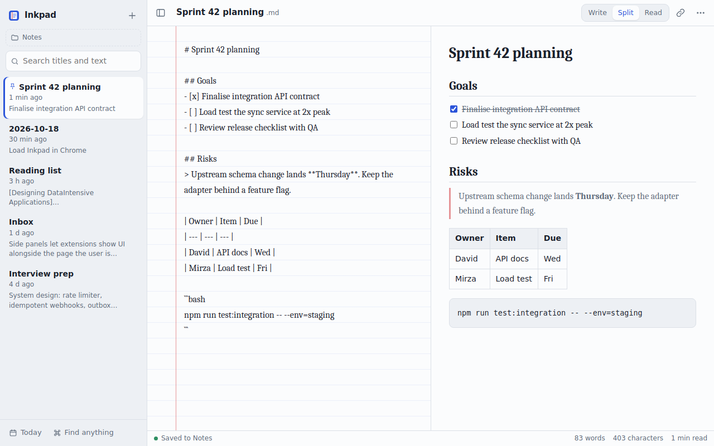

# Inkpad — Chrome notepad that saves to your disk

A fast Markdown notepad in Chrome's side panel. Every note is a plain `.md` file in a folder you choose, so notes survive browser restarts and open in any editor.



## Features
- Notes saved as real files (File System Access API); remembers your folder
- Autosave, crash recovery, reloads notes edited in other apps, conflict copies instead of overwrites
- Write / Split / Read views with Markdown preview, clickable task lists, tables, code
- Full-text search, pinned notes, Ctrl+K command palette, daily note (Alt+D)
- Right-click clipping of text, links and pages into `Inbox.md`
- Trash with Undo, light/dark themes, serif/sans/mono, ruled paper
- No servers, no tracking, no network requests ([privacy policy](PRIVACY.md))

## Install for development
1. Clone the repo.
2. Open `chrome://extensions`, enable **Developer mode**, click **Load unpacked**, select the `src` folder.
3. After code changes, click the reload icon on the extension card.

## Build for the Chrome Web Store
```bash
./scripts/package.sh        # -> dist/inkpad-<version>.zip
```
Pushing a tag like `v1.0.1` (matching `src/manifest.json`) builds the zip and attaches it to a GitHub release. Listing text, permission justifications and graphics are in `store/`.

## Shortcuts
| Keys | Action |
| --- | --- |
| Ctrl+Shift+Y | Open side panel |
| Alt+Shift+N | Open in a full tab |
| Ctrl+K | Command palette |
| Alt+N / Alt+D | New note / today's note |
| Ctrl+E | Cycle Write, Split, Read |
| Alt+L | Insert link to current page |
| Ctrl+B / Ctrl+I / Ctrl+Shift+X | Bold / italic / strikethrough |

## Project layout
```
src/       the extension (load this folder unpacked)
store/     Chrome Web Store listing copy, screenshots, promo tile
scripts/   packaging
docs:      CLAUDE.md (architecture), ROADMAP.md, CHANGELOG.md
```

## License
MIT
